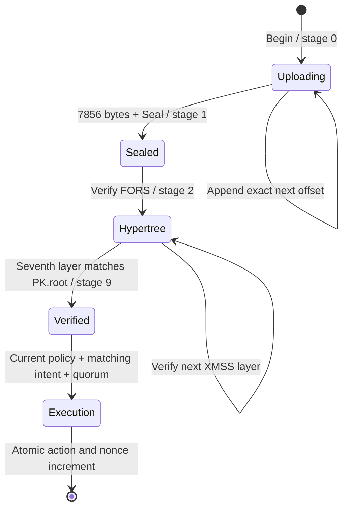

# Wallet protocol v1

All integer fields in the wallet protocol are unsigned little-endian. SLH-DSA's
internal hash addresses use the big-endian conventions required by FIPS 205.
These are separate encodings. Do not serialize a JavaScript number above
`Number.MAX_SAFE_INTEGER`; use bigint or a canonical decimal string.

## Cryptographic profile

The sole profile is `SLH-DSA-SHA2-128s`: 32-byte public keys, 64-byte secret keys,
and 7,856-byte signatures. The SLH context is the UTF-8 string
`QuantumSeal.Wallet.v1`. The SLH message is exactly:

```
SHA256(UTF8("QuantumSeal/Intent/v1") || encoded_intent)
```

The primitive uses **pure SLH-DSA over this application digest**, not the
standardized HashSLH-DSA prehash interface. There is no algorithm negotiation or
fallback to Ed25519. The approval JSON is a transport wrapper, not the signed
serialization. Its embedded public key is not trusted without a separate pin.
The informational signer index is resolved against the on-chain policy; it does
not permit choosing a different verification key.

## Permanent wallet address

```
wallet_id = SHA256(UTF8("QuantumSeal/Wallet/v1") || genesis[32] || salt[32] || initial_policy[138])
wallet_pda = find_program_address([UTF8("wallet"), wallet_id], program_id)
```

The ID commits to the initial policy, preventing someone who sees an address
initialization request from substituting their own keys at that same address.
Anyone can initialize the exact committed policy. The original ID and bump remain
unchanged through rotation and recovery; the active policy does not participate
in subsequent address derivation. Keep the public descriptor to reproduce the
initial commitment. Deriving an address does not initialize an account.

`genesis` is an explicit configured domain. The program checks consistency with
its stored value; it cannot independently fetch the cluster genesis hash. The
SDK compares it with the local RPC genesis hash. RPC trust and deployment identity
must be resolved before any real deployment.

## Policies

`Owners` is 98 bytes: `count:u8`, `threshold:u8`, and three 32-byte key slots.
Count is 1–3, threshold is 1–count. Active keys must be nonzero and distinct;
unused slots must be zero. `Policy` appends a 32-byte guardian and a u64 recovery
delay, for 138 bytes total. Zero guardian requires zero delay. Otherwise the
guardian must differ from every owner and the delay must be 150–2,000,000 slots.

The active key is selected from the owners by index 0–2. Index 255 selects the
recovery guardian. A guardian proof is accepted only for a recovery proposal.

## Intent serialization

| Field | Bytes |
|---|---:|
| Version, 1 or 2 | 1 |
| Genesis hash | 32 |
| Wallet program ID | 32 |
| Wallet PDA | 32 |
| Policy epoch | 8 |
| Execution nonce | 8 |
| Inclusive expiry slot | 8 |
| Action discriminator | 1 |
| Action payload | Variable |

Version 2 appends a fee refund after the action payload:

| Field | Bytes |
|---|---:|
| Fee-refund recipient | 32 |
| Fee-refund lamports, 1–10,000,000 | 8 |

The recipient may not be zero, the wallet PDA or the wallet program. Version 1 has
no refund block. The whole intent is at most 850 bytes; the largest version-2
invocation is 849. Parsing must consume all bytes.

| Action | Discriminator | Payload |
|---|---:|---|
| SOL transfer | 0 | Recipient[32], nonzero lamports:u64 |
| Replace policy | 1 | Policy[138] |
| Propose recovery | 2 | New Owners[98] |
| Cancel recovery | 3 | Empty |
| Invoke program | 4 | Target[32], count:u8, metas, data_length:u16, data |

Each CPI meta is a 32-byte address and one flag byte: bit 0 writable, bit 1 signer.
Other bits are forbidden. There are at most 12 metas, with no duplicate addresses,
and at most 256 data bytes. Only the wallet PDA may receive signer privilege.
When present, the wallet must be a **read-only signer** in the inner instruction.
Self-invocation and passing approval accounts into the callee are rejected. The
outer execution still marks the wallet writable so its nonce can advance.

All CPI target addresses, account order, privileges and instruction bytes are
signed. The callee's behavior and upgrade policy are not guaranteed by the wallet.
There is no multi-instruction DeFi adapter in v1.

## Account layouts

The wallet account has exactly **334 bytes**:

```
magic[8] = "QSWAL001"
bump:u8 | original_id[32] | genesis[32] | active_policy[138]
epoch:u64 | nonce:u64 | recovery_ready_at:u64 | pending_owners[98] | locked:bool
```

The proof account has a **193-byte header** followed by the 7,856-byte signature:

```
magic[8] = "QSPRF001"
bump:u8 | wallet[32] | uploader[32] | intent_digest[32] | selected_key[32]
epoch:u64 | nonce:u64 | expiry:u64 | signer_index:u8 | uploaded:u16
stage:u8 | intermediate_root[16] | tree_index:u64 | leaf_index:u32
```

Its total size is **8,049 bytes**. The proof PDA is:

```
find_program_address(["proof", wallet, digest, [signer_index], uploader], program_id)
```

The uploader binding isolates concurrent relayers and fixes the rent-refund
recipient. Owner, discriminator, exact size and PDA are validated when reading
an account. Account data is not accepted as an authority merely because it parses.

## Upload and verification state machine



Append is restricted to the original uploader, capped at 768 bytes, and cannot
rewrite earlier bytes. No writes are accepted after sealing. Sealing and
verification are permissionless. Every verification step checks epoch, nonce,
expiry, and the selected active key. The final root comparison is mandatory.

FORS plus seven XMSS steps can be batched into one transaction. The SDK defaults
to an eight-step batch and permits batches of 1, 2, 4 or 8 for measurements. The
program persists progress only after its own cryptographic work succeeds. Native
`Progress` structs are trusted intermediates, not independently valid proofs.

## Instruction ABI

| Tag | Instruction | Data after tag | Ordered accounts |
|---:|---|---|---|
| 0 | Initialize | genesis[32], salt[32], policy[138] | payer(w,s), wallet(w), system |
| 1 | Begin | index:u8, epoch:u64, nonce:u64, expiry:u64, digest[32] | wallet, proof(w), uploader(w,s), system |
| 2 | Append | offset:u16, bytes | wallet, proof(w), uploader(s) |
| 3 | Seal | Empty | wallet, proof(w) |
| 4 | Verify step | Empty | wallet, proof(w) |
| 5 | Execute | proof_count:u8, encoded intent | wallet(w), proofs, action accounts |
| 6 | Finalize recovery | Empty | wallet(w) |
| 7 | Close proof | Empty | proof(w), original uploader(w,s) |

`w` means writable; `s` means an outer transaction signer. For transfer, the sole
action account is the exact recipient. For CPI, action accounts are the executable
callee followed by the exact signed metas. Policy operations take none. A version-2
intent adds the fee-refund recipient (w) as the final account; it must match the
signed recipient and may not be the wallet or a proof account.

Initialization uses top-up, allocate and assign, so unsolicited rent-exempt
pre-funding does not prevent account creation. SOL transfers retain the wallet's
rent-exempt reserve. Closing a proof refunds only its original uploader and does
not change the wallet authority.

## Execution and recovery

Execution requires 1–3 distinct owner proofs meeting the current threshold, or
exactly one guardian proof for a recovery proposal. Every proof must be fully
verified and bind the same intent, epoch, nonce, expiry and wallet. Owner actions
increment the wallet nonce with the action. Failure rolls back both; there is no
partially spent nonce. Integer overflow fails closed.

A guardian recovery proposal does **not** consume the nonce, so a guardian cannot
invalidate the owners' in-flight approvals. It cannot be replayed: a second proposal
is refused while one is pending, and cancellation or finalization advances the nonce.

Approvals expire at an inclusive slot no more than 216,000 slots (about a day)
after the slot at which they are used; the program rejects longer horizons.

After the action, a version-2 intent moves its signed refund from the wallet to the
named recipient, still retaining the wallet's rent-exempt reserve. Clients use it
to reimburse the fee payer for the transactions of a send.

Before CPI, the incremented nonce and a transient lock are persisted. The inner
instruction gets only explicitly approved privileges. A failed CPI rolls back the
lock and nonce. The successful outer instruction clears the lock.

Rotation increments the epoch and clears pending recovery. On mainnet (identified
by the wallet's committed genesis hash) a policy with a guardian needs a recovery
delay of at least 216,000 slots, about a day, so owners have time to veto; other
clusters accept 150 slots for testing. A guardian proposal
records new owners and the earliest finalization slot. Existing owners may veto
with a threshold-approved cancellation or rotation; **ordinary spending does not
cancel recovery**. After the delay, anyone can finalize the recorded owners,
incrementing epoch and nonce while retaining the wallet address and guardian.
A cancellation and finalization racing after maturity are ordered by the chain.

Errors are stable custom codes beginning at 7000; 7023 (`ExpiryTooFar`) and 7024
(`InvalidFeeRefund`) were added with version-2 intents. The canonical enumeration is
`crates/wallet-core/src/lib.rs`; do not infer authorization success from logs alone.
